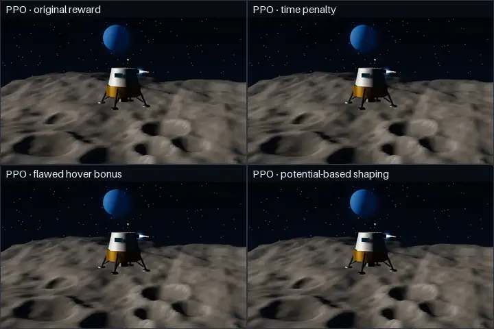
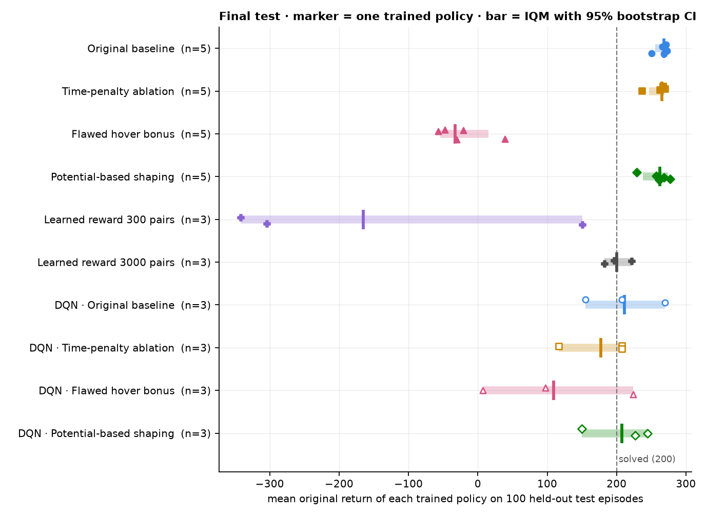

# LunarLab — Reward Shaping Mission Control

[](https://github.com/SHAYAN-ABRAR/lunarlab/actions/workflows/ci.yml)
[](https://shayan-abrar.github.io/lunarlab/)


A local-first laboratory for **honest reward-design experiments** on Gymnasium's `LunarLander-v3`
(discrete actions) with Stable-Baselines3, plus a mission-control web interface: train under fixed or
randomized physics, tune with Optuna, replay in 3-D with the policy's own view of every step, diagnose
reward hacking, compare PPO and DQN fairly, learn rewards from preferences, and fly the lander yourself.

<p align="center">
  
</p>
<p align="center"><sub>The same held-out episode flown by PPO policies trained with four reward designs, in LunarLab's 3-D replay.
The flawed hover bonus is exploited exactly as designed to be. Positions, engine firings and terrain are the recorded
data (LunarLander itself is 2-D): <a href="docs/media/showcase.gif">simulator footage of the same flights</a>.</sub></p>

**[Live demo](https://shayan-abrar.github.io/lunarlab/)** (a read-only snapshot of the real results) ·
**[Results write-up](docs/RESULTS.md)** · [How it works](docs/ARCHITECTURE.md)

## Results at a glance

38 policies, each evaluated on 100 held-out episodes with the unmodified environment reward
([full results, method and caveats](docs/RESULTS.md)):



| Group (PPO, 1M transitions) | Policies | IQM return [95% CI] | Pad landing | P(better than baseline) |
|---|---:|---:|---:|---:|
| Original reward | 5 | 268.6 [255, 272] | 98% | reference |
| Time penalty | 5 | 265.3 [247, 269] | 94% | 0.32 [0.00, 0.72] |
| **Flawed hover bonus** | 5 | **−33.1** [−54, 16] | **0%** | 0.00 |
| Potential-based shaping | 5 | 262.3 [238, 274] | 94% | 0.36 [0.00, 0.76] |
| Learned reward, 300 preference labels | 3 | −165.2 [−342, 151] | 12% | 0.00 |
| Learned reward, 3,000 preference labels | 3 | 200.2 [183, 222] | 54% | 0.00 |

A P(better than baseline) of 0.00 means that, in these few training runs, every policy of the group scored
below every baseline policy (complete separation; its bootstrap interval collapses to [0.00, 0.00]). It is not
a probability of zero for a future run.

- **Reward hacking, measured:** the hover-bonus policies landed in 0 of 500 test episodes and hit the time
  limit in 80%, even at their best checkpoints by the real reward.
- **No clear evidence that sound shaping helped here:** under this 1M-transition budget, time penalty and
  potential-based shaping did not show clear evidence of improvement over the original reward (every
  P(improvement) interval contains 0.5). Five training seeds do not establish that they are equally good either.
- **RLHF in miniature:** with 3,000 simulated preference labels, PPO learned to land with the learned reward as
  its only training signal; with 300, two of three runs drove the learned reward up while the true return
  stayed near −390. The original reward still enters twice: the simulated labeller compares true returns, and
  checkpoints are selected on validation episodes by the original reward.
- **Smarter label choice did not help:** picking the pairs a reward-model ensemble disagrees on matched but
  never beat picking them at random (accuracy 0.750 vs 0.755 after 1,000 simulated labels, 5 seeds; random
  was ahead at every count, always within the spread between seeds).
- **Robustness:** every policy degrades in wind it never saw (original reward: 266 calm → 93 in strong wind,
  pad landing 98% → 22%), whatever the reward design.
- **PPO vs DQN** (each at its reference budget, 1M vs 100k transitions): DQN policies varied far more
  (155–270 for the original reward). Matched-budget runs and a discount-factor ablation, which separate the
  algorithm from its γ, are built and smoke-tested but not yet run
  ([commands](docs/RESULTS.md#studies-built-but-not-yet-run)).

Every number comes from stored evaluations, regenerated by `python -m lunarlab results`.

### Reliability audit (October 2026)

An audit of the pipeline confirmed several defects. All are fixed, and re-checks of the stored data show that
none of them affected the published results: no number above changed
([findings, reproductions and tests](docs/AUDIT_FIXES.md) · [upgrade notes](docs/MIGRATION.md)).

- **DQN resume** restored only the network weights: the replay buffer came back empty and target-network
  updates fell out of phase. Resumable DQN checkpoints now carry the replay buffer and the full training state;
  older ones are refused for resume and offer a warm restart (a new run). None of the 12 published DQN runs was
  resumed.
- **Final-test freezing** recorded only a file name, and a frozen run could still train. The tested checkpoint
  is now an immutable, digest-checked copy, a frozen run never trains again, and an interrupted test is retried
  on the same bytes. No run trained during or after its freeze, and the checkpoints behind all 43 existing
  freeze records are byte-for-byte intact.
- **"Landed off pad"** also counted on-pad landings that failed the angle or leg-contact check. Outcome
  classifier v2 keeps them apart; re-checking all 11,500 published evaluation episodes relabelled none.
- **Protocols** with duplicate or overlapping seeds, or an undeclared environment, are now refused (all 44
  existing configurations are valid). Runs that follow an already-seen final test (warm restarts of tested
  runs, tuning applied on used test seeds) are labelled exploratory, and `--holdout-seeds` reserves untouched
  test seeds for confirmatory results.
- **Provenance:** training segments, evaluations and results now record the code revision, and demo exports
  are either release snapshots (clean tree, file and dependency-lock digests) or labelled drafts. The live demo
  is a release snapshot.
- A **Windows CI** job now covers the install, file locks, paths with spaces and the PowerShell scripts, and
  three statements above were worded more carefully (sound shaping, the learned reward's role, what a
  P(better) of 0.00 means).

## What's inside

- **Reward lab.** Reward terms are pure, tested functions behind one Gymnasium wrapper, and
  `training_reward = original_weight × original_reward + Σ terms` is checked on every transition. Presets:
  the original reward, a time-penalty ablation, an **intentionally flawed hover bonus**, and
  **potential-based shaping** `α(γΦ(s′) − Φ(s))` with the algorithm's discount, an absorbing terminal
  potential and correct time-limit truncation.
- **Evaluation that doesn't flatter the agent.** Original reward only, validated protocols with disjoint
  validation and test seeds, validation-selected checkpoints frozen as immutable copies before the test (a
  frozen run never trains again; interrupted tests are retried on the same bytes), exploratory labels for runs
  that follow an already-seen test, bootstrap and Wilson intervals, strict pad-landing / crash /
  out-of-bounds / time-limit rates with landing categories (on the pad but not strict, off the pad), a
  preset-independent hover detector and a documented reward-exploitation rule.
- **Statistics across seeds** (Agarwal et al., 2021): IQM, bootstrap intervals over training seeds,
  probability of improvement and performance profiles, in the UI and in reports.
- **Robustness and varied physics:** frozen policies re-fly the same test episodes under wind, turbulence
  and heavier gravity. Runs can also *train* with wind, turbulence and gravity randomized per episode
  (configurable ranges, seeded, logged), and are compared with fixed-physics training on calm and windy
  evaluations.
- **Algorithm comparison:** DQN alongside PPO with the same wrapper, protocol and safe checkpoint loading;
  matched transition budgets, learning curves against transitions or wall-clock time, several seeds per
  cell, and a separate discount-factor ablation with difference intervals.
- **Learned rewards (RLHF in miniature):** preference datasets from real flights, Bradley–Terry reward
  models validated on held-out episodes, PPO trained with the learned reward as its only training signal,
  and a page where *you*
  judge pairs of flights, picked at random or where a reward-model ensemble disagrees most.
- **Automatic tuning:** Optuna searches PPO/DQN settings and reward weights on validation episodes only,
  with bounded budgets, pruning, resume and cancel; the best settings then train fresh runs for the final
  test.
- **Fly It Yourself:** keyboard (or touch) control of the real physics at 50 Hz, scored and recorded like any
  policy, racing the ghost of a trained agent on the same terrain.
- **Flight Replay** in an immersive 3-D reconstruction (recorded pose, engines and contacts on the episode's
  real terrain) next to the actual simulator footage, with frame-accurate telemetry, per-step reward
  decomposition and what the policy computed at each step (PPO action probabilities, entropy and value; DQN
  Q-values); a **Reward Stress Test** re-scores recorded flights under other reward designs.
- **Engineering:** a local job supervisor (owned worker processes, cooperative stop at safe boundaries,
  resume with lineage, crash reconciliation), parallel experiment runs, weights-only model loading, loopback
  binding and strict request validation, crash-safe checkpoint bundles with full DQN continuation (replay
  buffer included), 270 Python tests and 15 browser flows, Linux and Windows CI, and a static demo build
  whose snapshots record their exact provenance.

## Requirements

- Windows 10/11 with PowerShell (Linux works as a secondary path, see below).
- **Python 3.12 or 3.13.** Box2D 2.3.10 and pygame 2.6.1 publish Windows wheels only up to 3.13. Python 3.14
  is not supported yet. [uv](https://docs.astral.sh/uv/) is used automatically if installed.
- **Node.js ≥ 22.12** (or ^20.19) to build the UI. Node is not needed to *run* an already built UI.
- No GPU needed: PPO with a 64×64 MLP runs on the CPU, which is the default.

## Install and launch (Windows PowerShell)

```powershell
cd "D:\Rocket"                                                     # your project folder; spaces are fine
powershell -ExecutionPolicy Bypass -File scripts\setup.ps1          # venv, locked deps, UI build, self-check
powershell -ExecutionPolicy Bypass -File scripts\start.ps1          # serves http://127.0.0.1:8765 and opens it
powershell -ExecutionPolicy Bypass -File scripts\stop.ps1           # graceful stop (from another terminal)
```

`-ExecutionPolicy Bypass` applies to that single process; your machine's policy is not changed.
`start.ps1 -Background -NoBrowser` runs the server without a console window.

The app is at **http://127.0.0.1:8765** and binds to loopback only.

### Linux (secondary path)

```bash
uv venv --python 3.12 .venv && uv pip install --python .venv/bin/python -r requirements.lock
uv pip install --python .venv/bin/python --no-deps -e .
(cd frontend && npm ci && npm run build)
.venv/bin/python -m lunarlab doctor
.venv/bin/python -m lunarlab serve            # http://127.0.0.1:8765
```

On Linux, PyPI's torch wheel includes CUDA libraries (several GB). For a CPU-only install, first run
`uv pip install --python .venv/bin/python torch --index-url https://download.pytorch.org/whl/cpu`.

## First run (about five minutes)

1. **Mission Overview → Watch Random Agent.** Records one real episode of uniformly random actions on the
   shared demonstration seed 20000 and opens it in Flight Replay.
2. **Train Baseline → Smoke → Start.** About 15 s. Watch transitions, throughput, validation and PPO
   diagnostics update in the Training Console. A SMOKE run is a pipeline test, not a trained agent.
3. On the run page: **Evaluate (validation)**, then **Record flight…** on seed 20000, and replay it next to
   the random flight (Flight Replay → Side-by-side). Step through it with ← / → to see the policy's action
   probabilities at each step.
4. **Reward Studio:** open *Flawed hover bonus*, read the discounted-return calculator, change a threshold
   and save a new revision.
5. When ready for real experiments: **Training Console → Multi-seed experiment suite** (4 presets × 3 seeds,
   STANDARD ≈ 1M transitions each). Run the throughput benchmark first for a time estimate.
6. **Fly It Yourself:** pick a ghost (Gymnasium's heuristic or a trained run), press Start, and land with
   ↑ / ← / →. Your flight is saved and opens in Flight Replay.

## CLI

Everything in the UI is also available from the command line (same core code):

```powershell
.venv\Scripts\python.exe -m lunarlab doctor
.venv\Scripts\python.exe -m lunarlab random-demo --episode-seed 20000
.venv\Scripts\python.exe -m lunarlab heuristic-demo --episode-seed 20000
.venv\Scripts\python.exe -m lunarlab train --preset baseline --profile smoke
.venv\Scripts\python.exe -m lunarlab train --preset hover-bonus --profile standard --seed 42
.venv\Scripts\python.exe -m lunarlab train --preset potential --profile standard --seed 42
.venv\Scripts\python.exe -m lunarlab stop --run-id <id>             # or Ctrl+C once in the training terminal
.venv\Scripts\python.exe -m lunarlab resume --run-id <id>
.venv\Scripts\python.exe -m lunarlab evaluate --run-id <id> --split validation
.venv\Scripts\python.exe -m lunarlab evaluate --run-id <id> --split test      # freezes the selected checkpoint
.venv\Scripts\python.exe -m lunarlab record --run-id <id> --episode-seed 20000
.venv\Scripts\python.exe -m lunarlab compare --experiment-id <id>
.venv\Scripts\python.exe -m lunarlab report --experiment-id <id>
.venv\Scripts\python.exe -m lunarlab runs
.venv\Scripts\python.exe -m lunarlab benchmark
.venv\Scripts\python.exe -m lunarlab rescore --recording-id <id>
.venv\Scripts\python.exe -m lunarlab suite --presets baseline,time-penalty,hover-bonus,potential --seeds 0,1,2 --profile standard
.venv\Scripts\python.exe -m lunarlab sweep --bonus 0.25,0.5,1,2 --seeds 0 --profile standard     # development sweep (validation only)
.venv\Scripts\python.exe -m lunarlab reward export --preset hover-bonus -o my-reward.yaml
.venv\Scripts\python.exe -m lunarlab train --reward-config my-reward.yaml --profile smoke
.venv\Scripts\python.exe -m lunarlab processes                     # list this project's server/worker processes
.venv\Scripts\python.exe -m lunarlab suite ... --parallel 5             # train several runs at once
.venv\Scripts\python.exe -m lunarlab suite --algo dqn ...               # the same experiment with DQN
.venv\Scripts\python.exe -m lunarlab suite --algos ppo,dqn --gammas 0.99,0.999 ...   # matched budgets + discount-factor ablation
.venv\Scripts\python.exe -m lunarlab suite --presets baseline --physics both ...   # fixed vs randomized training physics
.venv\Scripts\python.exe -m lunarlab train --preset baseline --physics randomized --wind-power 0,10 --gravity=-11,-9
.venv\Scripts\python.exe -m lunarlab run-experiment --experiment-id <id> --parallel 4   # resume/finish + final tests
.venv\Scripts\python.exe -m lunarlab robustness --experiment-id <id> --parallel 8
.venv\Scripts\python.exe -m lunarlab rlhf-study --from-experiment <id> --pairs 300,3000 --parallel 6
.venv\Scripts\python.exe -m lunarlab rlhf-dataset --from-experiment <id>   # or step by step:
.venv\Scripts\python.exe -m lunarlab reward-model --dataset-id <ds> --pairs 3000 --include-human --members 5
.venv\Scripts\python.exe -m lunarlab rlhf-active --dataset-id <ds> --seeds 0,1,2,3,4   # active vs random label selection
.venv\Scripts\python.exe -m lunarlab tune --algo ppo --preset potential --trials 20 --transitions 200000   # Optuna, validation only
.venv\Scripts\python.exe -m lunarlab tune-status --study-id <id>        # tune-resume / tune-cancel / tune-apply as well
.venv\Scripts\python.exe -m lunarlab suite ... --holdout-seeds 30000:100   # untouched final-test seeds (confirmatory)
.venv\Scripts\python.exe -m lunarlab warm-restart --run-id <id> --confirm   # NEW run from a checkpoint (not a resume)
.venv\Scripts\python.exe -m lunarlab test-status --run-id <id>            # frozen checkpoint, final-test attempts
.venv\Scripts\python.exe -m lunarlab freeze-migrate --all --dry-run      # legacy freeze records -> immutable copies
.venv\Scripts\python.exe -m lunarlab reclassify-outcomes --experiment-id <id> --out <dir>   # derived v2 outcome report
.venv\Scripts\python.exe -m lunarlab record-showcase --experiment-id <id> --references
.venv\Scripts\python.exe -m lunarlab results --experiment-ids <id1>,<id2> --out docs/results
.venv\Scripts\python.exe -m lunarlab export-demo --experiment-ids <id1>,<id2>   # release snapshot (clean tree; --draft otherwise)
```

Profiles: `smoke` (8,192 transitions, technical test), `standard` (1,000,000 requested → 1,003,520 actual
transitions, because PPO completes whole rollouts of 4,096), `extended` (3,000,000, explicit launch only).

### Reproducing the full experiment

The exact commands behind [docs/RESULTS.md](docs/RESULTS.md) are listed at its end. The basic version:

```powershell
.venv\Scripts\python.exe -m lunarlab benchmark                                   # ~1 min, for time estimates
.venv\Scripts\python.exe -m lunarlab suite --presets baseline,time-penalty,hover-bonus,potential --seeds 0,1,2 --profile standard --yes
.venv\Scripts\python.exe -m lunarlab compare --experiment-id <printed id>
.venv\Scripts\python.exe -m lunarlab report  --experiment-id <printed id>
```

The suite trains the runs (one at a time, or `--parallel N` at once), then evaluates each run's
validation-selected checkpoint once on the 100 final-test seeds. On the development laptop (i7-13620H) the
benchmark's short bursts reach about 5,000 transitions/s, but sustained training ran at 2,100–2,400
transitions/s for a single run (a STANDARD run in about 8–10 minutes) and 1,000–1,200 per run with five in
parallel (the 20-run study took 81 minutes while a DQN study shared the CPU). The laptop must stay awake.

## Where things are stored

```
data/lunarlab.sqlite        jobs, reward-config revisions, settings (metadata only)
data/demos/                 random / heuristic demonstration flights (mp4 + telemetry json)
data/experiments/           experiment definitions (groups of runs)
data/jobs/<job>/            worker log, status and result of each job
runs/<run_id>/              config.yaml, metadata.json, status.json, events.jsonl, episodes.csv,
                            metrics.jsonl, evaluations/, checkpoints/, trajectories/, videos/
reports/<id>/               report.md, report.html, figures, portfolio_summary.md
data/flights/               keyboard flights (mp4 + telemetry, policy kind "human")
data/preferences/<dataset>/ flight segments for preference learning, human labels (jsonl), active-learning studies
data/tuning/<study>/        Optuna studies (study.json, optuna.sqlite3, status.json)
data/reward_models/<id>/    learned reward models (npz weights + metadata with SHA-256)
demo/api/                   the exported snapshot behind the static demo (committed)
runs/<run_id>/checkpoints/frozen/   immutable, read-only copy of the checkpoint frozen for the final test
runs/<run_id>/checkpoints/*.replay.npz, *.state.json   DQN continuation state (two most recent kept)
data/test_exposure.jsonl    every completed final test (decides exploratory vs confirmatory)
```

Nothing is deleted automatically, with one exception: a DQN run keeps the replay and state files of its two most
recent resumable checkpoints and removes older ones (their weights stay, usable for evaluation). Checkpoints for
a 64×64 MLP are about 150 KB each; a DQN replay file with the default 50k buffer is about 4 MB.

## Documentation

- [docs/RESULTS.md](docs/RESULTS.md): the experiments, findings with intervals, figures, limitations and
  the commands that reproduce them.
- [docs/REWARDS.md](docs/REWARDS.md): the original reward, the four presets, learned rewards, formulas, assumptions, why
  shaped scores are not comparable, discounted-return reasoning, termination vs truncation.
- [docs/EVALUATION.md](docs/EVALUATION.md): the protocol, outcome definitions (including an environment
  contact-flag quirk), statistics across seeds, robustness conditions, training under varied physics,
  tuning without touching the test set, PPO–DQN comparisons and the discount-factor ablation, policy
  diagnostics, the reward-exploitation rule, final-test freezing, landing categories, test exposure and
  holdouts.
- [docs/ARCHITECTURE.md](docs/ARCHITECTURE.md): codebase map, wrapper order, experiment variants, physics
  randomization, active preference learning, Optuna tuning, job supervisor, the checkpoint contract (DQN
  continuation, crash-safe bundles), stop, resume, warm restarts and shutdown, final-test freezing and locks,
  provenance, storage, security model and design decisions.
- [docs/TROUBLESHOOTING.md](docs/TROUBLESHOOTING.md): Box2D/SWIG, Python versions, Node, ports,
  antivirus file locks, sleep.
- [docs/PORTFOLIO.md](docs/PORTFOLIO.md): how to produce an evidence-gated portfolio summary.
- [notebooks/walkthrough.py](notebooks/walkthrough.py): a VS Code `# %%` walkthrough using the project code.
- [docs/AUDIT_FIXES.md](docs/AUDIT_FIXES.md): the October 2026 audit findings, reproductions, fixes and tests;
  [docs/MIGRATION.md](docs/MIGRATION.md): what changed and the optional migration steps.
- [PROGRESS.md](PROGRESS.md): what is done, test evidence, known issues, next steps.

## Tests

```powershell
.venv\Scripts\python.exe -m pytest                       # 270 tests: unit, integration, real PPO/DQN, subprocesses
.venv\Scripts\python.exe -m ruff check lunarlab tests
cd frontend; npm run typecheck; npm run lint; npm run build
npx playwright test                                      # 15 browser flows on real backends (uses installed Edge)
```


This is a 2D/3D simulation benchmark. Nothing here is evidence of real-world rocket-control capability.
