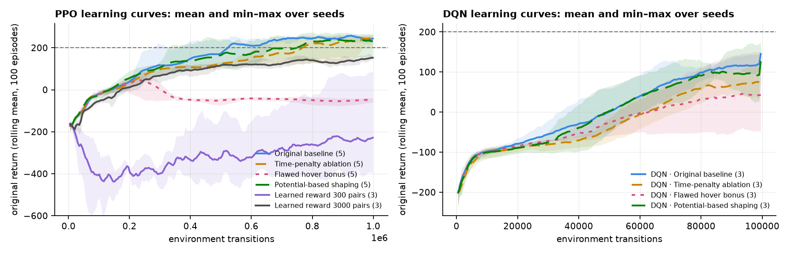
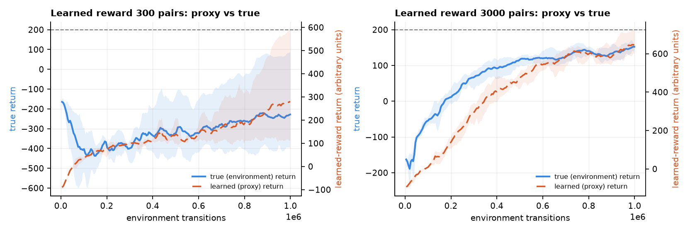
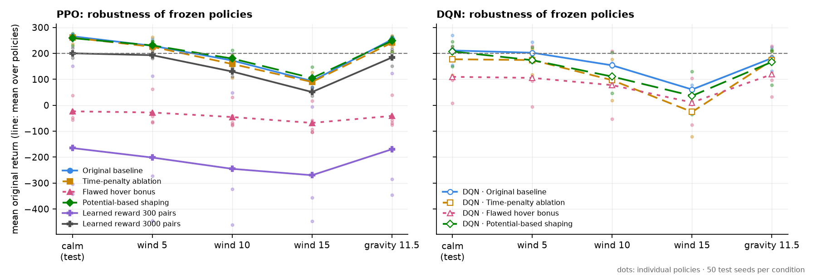
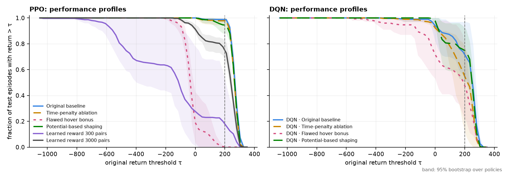
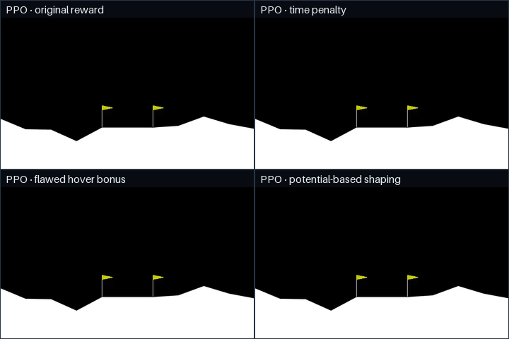

# Results

Three experiments, 38 trained policies, all evaluated the same way: the validation-selected checkpoint of
each run is frozen and flies **100 held-out test episodes** (seeds 20000–20099) with the **original
environment reward**, deterministically. Robustness evaluations re-fly the first 50 of those episodes under
changed physics. Protocol details: [EVALUATION.md](EVALUATION.md). Every number below was generated by
`python -m lunarlab results` from the stored evaluations ([tables](results/tables.md),
[raw data](results/results.json)); the per-policy table lists every run id.

| Experiment | Runs | Budget per run | Wall clock (development laptop) |
|---|---|---|---|
| Reward shaping study: 4 reward designs × 5 seeds, PPO | 20 | 1,003,520 transitions | 81 min, 5 runs in parallel |
| Algorithm comparison: the same 4 designs × 3 seeds, DQN | 12 | 100,000 transitions | 82 min, 4 in parallel |
| Learned rewards (RLHF in miniature): 2 reward models × 3 seeds, PPO | 6 | 1,003,520 transitions | 24 min incl. dataset and reward models, 6 in parallel |

Hardware: Intel i7-13620H laptop CPU (10 cores), no GPU. The experiments partly overlapped on the CPU.


## Findings

**1. The flawed hover bonus is exploited, measurably.** All five PPO policies trained with it landed on the
pad in **0 of 500** test episodes (environment success 12%, time limit 80%), and spent 32–87% of their
episodes in the hover band. IQM original return **−33.1** [95% CI −54, 16] versus **268.6** [255, 272] for the
original reward. These are the *best* checkpoints these runs produced by the original reward's own measure
(validation picked checkpoints from as early as 53k transitions); later checkpoints of these runs scored
lower on validation.
P(improvement) over the baseline: 0.00 [0.00, 0.00]: every hover-bonus policy scored below every baseline
policy, a complete separation of five runs against five, for which the empirical bootstrap interval can only
collapse. It is not evidence that a future run has literally no chance of doing better.

**2. No clear evidence that the two sound designs improved on the original reward at 1M transitions.**
Time penalty: IQM 265.3 [247, 269], pad landing 94%. Potential-based shaping: IQM 262.3 [238, 274], pad landing
94%. Original reward: 268.6 [255, 272], 98%. P(improvement) over the baseline is 0.32 [0.00, 0.72] and 0.36
[0.00, 0.76]: both intervals contain 0.5, so under this training budget the results do not show clear evidence
of improvement over the baseline, and five training seeds do not establish that the three designs are equally
good either. The theory (Ng, Harada & Russell, 1999) says potential-based shaping leaves the optimal policies of
the discounted problem unchanged; it says nothing about learning speed, about what PPO finds in 1M
transitions, about the undiscounted test return or about changed physics. Empirically, its policies met no
criterion of the reward-exploitation rule and landed on the pad in 94% of test episodes; its learning curve was
not clearly faster.



*Correction (2026-10-16):* the learning-curve figure first published here averaged potential-based shaping over
4 of its 5 seeds. Seed 1 stopped on a Windows file lock and was resumed by a newer LunarLab that logged one
more column per episode; the mixed rows made its training log unreadable to the figure code, which skipped it
without saying so. The log is now read row by row (and a resumed run keeps its log's original columns), so the
figure includes all five seeds: the mean curve ends at 214 instead of 234. Final-test results come from
evaluations, not training logs, and are unchanged, as is the conclusion above.

**3. Learning a reward from preferences works, if there are enough labels.** Reward models were fitted to
pairwise preferences between 40-step flight segments (1,115 segments from random, heuristic and PPO policies
at several training stages; a simulated human prefers the segment with the higher true return, with
Bradley–Terry noise). PPO was then trained with the learned reward as its **only training signal**
(environment reward weight 0). The original reward still entered the pipeline twice: the simulated labeller's
preferences compare true returns, and each run's checkpoint was selected on validation episodes by the original
reward.

| Reward model | Accuracy vs true order | Segment-return correlation | Per-step correlation | PPO result (3 seeds) |
|---|---:|---:|---:|---|
| 300 labels | 0.734 | 0.800 | 0.129 | IQM −165.2; returns 151, −305, −342 |
| 3,000 labels | 0.765 | 0.834 | 0.166 | IQM **200.2** [183, 222]; 81% success, 54% pad landing |

With 3,000 labels, every policy learned to land with the learned reward as its training signal, though below
the original-reward baseline (P(improvement) 0.00: complete separation of three runs against five). With 300 labels, two of three runs show **reward-model over-optimization**:
their learned (proxy) return rose from about 0 to 118–145 during training while their true return stayed
around −390 (they crash or fly out of bounds). Both reward models rank segments similarly well; what differs
is how well the per-step signal holds up where the policy goes, which the next figure shows.

*Correction (2026-10-16):* the reward models above were validated on a split by **segment**, so overlapping
windows of one episode could sit on both sides and flatter the validation metrics (their training data was not
affected: no human labels were used). Validation is now split by whole episode. Re-fitting the same two
configurations on the same dataset with the episode split gives accuracy vs true order **0.685** (300 labels)
and **0.780** (3,000 labels), one refit each (`python -m lunarlab reward-model --dataset-id
ds-20261015-235812-rlhf-5029 --pairs 300`, or `--pairs 3000`; deterministic). They are measured on 200 and 595
validation pairs, standard errors of about 0.03 and 0.02, so neither difference from the table is conclusive.
The PPO results are evaluations on the environment and are unaffected.



**4. Every policy degrades in wind it never saw; reward design barely changes that.** Mean original return of
the PPO original-reward policies: 266 calm → 229 (wind 5) → 173 (wind 10) → 93 (wind 15); pad landing falls
from 98% to 22%. Heavier gravity (−11.5 instead of −10) costs little (253, 93%). Time penalty and
potential-based shaping track the baseline within the spread of individual policies (wind 15: 90 and 105).



**5. DQN at its reference budget is far less consistent than PPO.** With RL Baselines3 Zoo's settings and
100k transitions, DQN's original-reward policies scored 155, 208 and 270 (IQM 211.0, pad landing 54%) against
PPO's 250–273 at 1M transitions. The comparison is between each algorithm at its reference budget, not at
equal experience. One difference is worth a hypothesis: the hover bonus hurt DQN much less (IQM 109.6; one
policy landed in 84% of episodes). DQN discounts with γ = 0.99, PPO with γ = 0.999: a 900-step hover is
worth about 100 bonus units at γ = 0.99 and about 594 at γ = 0.999 (the Reward Studio calculator shows the
same arithmetic). Budget and algorithm also differ, so this experiment does not isolate γ. The
discount-factor ablation added since (both algorithms at both discount factors, matched budgets; commands
below) is built to isolate it. It has not been run yet.



**6. Choosing labels by ensemble disagreement did not beat choosing them at random.** On the same 1,115
segments and simulated human as finding 3, reward-model ensembles (5 bootstrap members) started from 100
random labels and received 100 more per round, chosen either at random or as the pairs the ensemble disagreed
on most (largest spread of the members' P(A ≻ B) among 2,000 random candidate pairs). Five seeds per strategy;
each seed's initial labels are shared by both strategies. Accuracy against the true order on pairs from
held-out episodes, mean over seeds (min–max over seeds):

| Labels | Random | Disagreement |
|---:|---:|---:|
| 100 | 0.651 (0.599–0.696) | same labels |
| 200 | 0.729 (0.701–0.751) | 0.721 (0.712–0.736) |
| 400 | 0.747 (0.731–0.784) | 0.724 (0.681–0.766) |
| 700 | 0.757 (0.741–0.771) | 0.737 (0.710–0.784) |
| 1,000 | 0.755 (0.714–0.789) | 0.750 (0.732–0.781) |

Random selection was ahead at every count after the first round, by 0.005–0.023, always within the spread
between seeds: in this setup, active selection did not save labels. One possible reason, not tested here: the
simulated human is noisiest on pairs with close returns, which are also the pairs an ensemble disagrees on.
Reward-model accuracy only; no PPO policy was trained on these ensembles (study
`al-20261016-132738-active-3c64`, `python -m lunarlab rlhf-active --dataset-id ds-20261015-235812-rlhf-5029
--seeds 0,1,2,3,4`).

## Aggregate results

| Group | Policies | IQM [95% CI] | Mean [95% CI] | Pad landing | Env. success | Crash | Time limit | P(improvement) vs PPO baseline |
|---|---:|---:|---:|---:|---:|---:|---:|---:|
| Original baseline | 5 | 268.6 [255, 272] | 265.8 [258, 271] | 98% | 99% | 1% | 0% | reference |
| Time-penalty ablation | 5 | 265.3 [247, 269] | 260.4 [249, 268] | 94% | 98% | 2% | 0% | 0.32 [0.00, 0.72] |
| Flawed hover bonus | 5 | −33.1 [−54, 16] | −23.5 [−48, 8] | 0% | 12% | 7% | 80% | 0.00 [0.00, 0.00] |
| Potential-based shaping | 5 | 262.3 [238, 274] | 258.6 [242, 271] | 94% | 95% | 1% | 4% | 0.36 [0.00, 0.76] |
| Learned reward, 300 labels | 3 | −165.2 [−342, 151] | −165.2 [−342, 151] | 12% | 23% | 38% | 0% | 0.00 [0.00, 0.00] |
| Learned reward, 3,000 labels | 3 | 200.2 [183, 222] | 200.2 [183, 222] | 54% | 81% | 17% | 1% | 0.00 [0.00, 0.00] |
| DQN · original baseline | 3 | 211.0 [155, 270] | 211.0 [155, 270] | 54% | 77% | 11% | 11% | 0.20 [0.00, 0.67] |
| DQN · time penalty | 3 | 177.2 [117, 207] | 177.2 [117, 207] | 31% | 62% | 8% | 28% | 0.00 [0.00, 0.00] |
| DQN · flawed hover bonus | 3 | 109.6 [7, 224] | 109.6 [7, 224] | 41% | 60% | 22% | 14% | 0.00 [0.00, 0.00] |
| DQN · potential-based shaping | 3 | 207.2 [150, 245] | 207.2 [150, 245] | 61% | 75% | 20% | 5% | 0.00 [0.00, 0.00] |

IQM = interquartile mean of the per-policy mean returns (with 3 policies it equals the mean). Intervals are
95% bootstraps over policies (the resampling unit is the training run). Rates are means over policies.
P(improvement) is P(X > Y) + ½·P(X = Y) over all pairs of policies (Mann–Whitney); 0.00 [0.00, 0.00] means
complete separation in these few runs, where the empirical bootstrap interval collapses, not a zero probability
for future runs. An interval that contains 0.5 means the data cannot order two groups; it does not show that they
are equally good. For the per-policy numbers, with intervals over
episodes, see [results/tables.md](results/tables.md).

A single EXTENDED baseline run (3M transitions, training seed 99, not part of the study) scored 272.4
[263.9, 279.6] with 94% pad landing at its validation-selected checkpoint (1.9M transitions): no better than
the 1M runs beyond noise.

## Side-by-side flights

The first test episode (seed 20000, fixed before any result was seen), flown by the training-seed-0 policy
of each PPO group. Real simulator footage:



The hover-bonus policy's episode ends at the 1,000-step time limit (20 s); the GIF shows the first 12 s.
The README shows the same four flights in the 3-D replay (`media/showcase-3d.webp`), rendered frame by frame
from the recorded telemetry by `frontend/tools/capture3d.mjs` and composed with `python -m lunarlab showcase`.

## Limitations

- **Few seeds.** Five per PPO group, three per DQN and learned-reward group. The intervals above are wide on
  purpose; differences inside them are not findings.
- **One environment, one set of hyperparameters per algorithm.** PPO and DQN use RL Baselines3 Zoo's
  LunarLander settings without tuning per reward design.
- **Simulated preferences.** The "human" is a Bradley–Terry model of the true segment return. Real people
  judge differently (the Learned Rewards page lets you label pairs and compare with the true returns).
- **Checkpoint selection uses the original reward on validation seeds.** That is the right protocol for
  comparing reward designs on the real task, and it flatters the flawed designs: without it, the hover-bonus
  and 300-label results would be worse.
- **One interrupted run.** Potential-based shaping, seed 1 failed at 200,704 transitions on a Windows file
  lock (fixed since; see ARCHITECTURE.md) and was resumed from its last periodic checkpoint. A resumed run is
  not bit-identical to an uninterrupted one; its lineage is recorded in its metadata.
- **2-D simulation.** Nothing here says anything about real rockets.

## Correction: outcome classification (2026-10-17)

LunarLab's outcome classifier was revised (version 2, see EVALUATION.md). Version 1 marked *every* clean
landing at rest that was not a strict pad landing as "landed off pad", including a lander resting between the
flags that only failed the angle or leg-contact criterion. The definition of a **strict pad landing** did not
change, and none of the numbers above used the "off pad" field. All published evaluation files were
re-examined from their stored episode fields without modifying them
([results/outcome_reclassification_v2.md](results/outcome_reclassification_v2.md), with each source file's
SHA-256): 191 files and 11,500 episodes, 5,071 strict pad landings, 1,625 episodes "landed off pad" under
version 1 and the same 1,625 under version 2. No episode in these results was an on-pad landing that version 1
mislabelled; the defect existed in the code (regression tests reproduce it) but did not affect this data.
Version 1 did not store leg positions, so version 2's "landed off pad" cannot separate straddling from
outside for these files.

## Reproduce

```powershell
.venv\Scripts\python.exe -m lunarlab suite --presets baseline,time-penalty,hover-bonus,potential --seeds 0,1,2,3,4 --profile standard --name reward-shaping-study --parallel 5 --yes
.venv\Scripts\python.exe -m lunarlab suite --algo dqn --presets baseline,time-penalty,hover-bonus,potential --seeds 0,1,2 --profile standard --total-transitions 100000 --checkpoint-every 20000 --validation-every 10000 --name dqn-comparison --parallel 4 --yes
.venv\Scripts\python.exe -m lunarlab rlhf-study --from-experiment <reward-shaping-study id> --source-seeds 0,1 --episodes 20 --pairs 300,3000 --seeds 0,1,2 --parallel 6
.venv\Scripts\python.exe -m lunarlab robustness --experiment-id <id> --parallel 8          # for each experiment
.venv\Scripts\python.exe -m lunarlab record-showcase --experiment-id <id> --references
.venv\Scripts\python.exe -m lunarlab results --experiment-ids <id1>,<id2>,<id3> --out docs/results
```

Training is deterministic for a given seed on the same machine and library versions; across machines, small
numerical differences change individual runs, so expect the same picture rather than the same digits.

## Studies built but not yet run

These features were verified with small smoke experiments (technical tests whose numbers mean nothing); the
studies below would produce findings, and none of their results exist yet. Times are rough, for the
development laptop.

```powershell
# PPO vs DQN at matched budgets, crossed with the discount factor (the 2 x 2 ablation behind finding 5's
# hypothesis): 2 rewards x 4 variants x 5 seeds = 40 runs of 303,104 transitions each. DQN ran at 48-98
# transitions/s per run in the published experiment, so a DQN run takes about 1-1.75 h: roughly 4-7 h with 6 in parallel.
.venv\Scripts\python.exe -m lunarlab suite --presets baseline,hover-bonus --algos ppo,dqn --gammas 0.99,0.999 --seeds 0,1,2,3,4 --total-transitions 300000 --name gamma-ablation --parallel 6 --yes
.venv\Scripts\python.exe -m lunarlab compare --experiment-id <id>      # ablation table; results draws algorithm_comparison.png

# Fixed vs randomized training physics, evaluated calm and windy: 20 PPO runs at 1M (~1.5 h with 5 in parallel).
.venv\Scripts\python.exe -m lunarlab suite --presets baseline,potential --physics both --seeds 0,1,2,3,4 --profile standard --name physics-study --parallel 5 --yes
.venv\Scripts\python.exe -m lunarlab robustness --experiment-id <id> --parallel 8

# Active vs random labels, carried through to PPO: 6 ensembles, then 12 PPO runs at 1M on them (the published
# learned-reward runs took ~20 min each with 6 in parallel; 5-member ensembles cost more per step).
.venv\Scripts\python.exe -m lunarlab rlhf-active --dataset-id ds-20261015-235812-rlhf-5029 --seeds 0,1,2 --register
.venv\Scripts\python.exe -m lunarlab rlhf-study --reward-models <the 6 printed ids> --seeds 0,1 --parallel 6

# Tuning on validation, then fresh runs of the best settings for the final test. 30 trials of 303,104
# transitions, one at a time: up to ~3 h, less when trials are pruned.
.venv\Scripts\python.exe -m lunarlab tune --algo ppo --preset potential --trials 30 --transitions 300000 --name potential-tuning
.venv\Scripts\python.exe -m lunarlab tune-apply --study-id <id> --seeds 0,1,2,3,4 --profile standard --parallel 5
```
