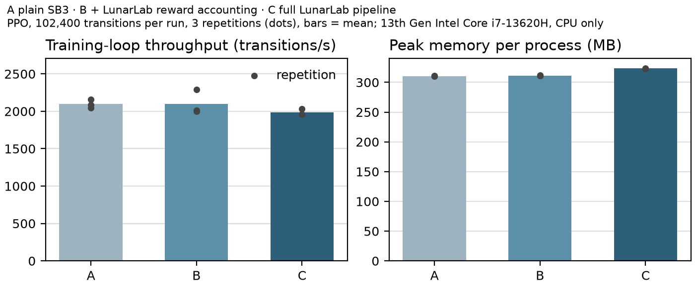

# Benchmark protocol: LunarLab's instrumentation overhead

**Question.** How much time and memory does LunarLab's research instrumentation cost compared with training the
same model with plain Stable-Baselines3? (MLOSS reviewers weigh "comparison to previous … related
implementations, w.r.t. run-time, memory requirements, features".)

**Command.** `python -m lunarlab overhead-benchmark --profile smoke|standard|comprehensive` (implementation:
`lunarlab/overhead.py`; tests: `tests/test_overhead.py`). The comprehensive profile asks for confirmation and is
never started automatically. `python -m lunarlab.overhead --render <folder>` re-creates a folder's table and
figures from its saved raw measurements.

## Configurations

| | Environment stack | Training call |
|---|---|---|
| **A · plain SB3** | `DummyVecEnv([Monitor(gym.make("LunarLander-v3", continuous=False))] × 4)` | `PPO(...).learn(N)` |
| **B · + reward accounting** | `DummyVecEnv([Monitor(LunarLabRewardWrapper(gym.make(...)))] × 4)` (baseline preset: training reward = original reward; per-transition accounting, episode accumulator, outcome classification) | `PPO(...).learn(N)` |
| **C · full LunarLab pipeline** | as B | `lunarlab.training.train(run_id)`: run directory, configuration and metadata records, episode CSV, metrics, status file, stop polling, periodic checkpoints and validation episodes |

**Held equal across A, B and C:** algorithm and hyperparameters (LunarLab's PPO defaults: 4 environments × 1,024
steps per rollout, minibatch 64, 4 epochs, γ = 0.999, GAE λ = 0.98, 64×64 tanh actor and critic, 9,797
parameters) — all three construct SB3's own `PPO` through the same call, and the harness records each run's
hyperparameters and refuses to report if they differ; environment and physics; transition budget (PPO completes
whole rollouts, so budgets are multiples of 4,096 and every run trains exactly the same number of transitions);
`DummyVecEnv`; CPU; one torch thread; seed 0 and the same worker seeds; no rendering.

**What differs, and how it is handled.** C also evaluates the policy on 10 validation episodes at the start,
every N/4 transitions and at the end, and writes a checkpoint every N/4 transitions and at the end (the same
cadence as a real run, scaled to the budget). Validation episodes are *additional environment steps*, not
instrumentation overhead, so their wall time and environment steps are measured separately (by timing
`evaluate_policy` and `save_model_atomic` inside the benchmark process) and excluded from C's training-loop time.
They are reported in their own columns.

**Measurement.** Each repetition runs in a fresh Python process (peak memory is per process and configuration);
the order of A, B and C rotates between repetitions; every repetition is kept. Training-loop time is measured
from environment construction to the end of `learn()`/`train()` (minus C's validation and checkpoint time). CPU
utilisation is process CPU time divided by wall time. Peak memory is the peak working set (Windows) or
`ru_maxrss` (Linux). Artifact size: A and B save one SB3 model file; C's whole run directory. The cost of
recording one episode (video and per-step telemetry) is measured separately after C's training.

## Results (measured)

Machine: Intel Core i7-13620H (10 cores, 16 logical), Windows 11, 16 GB RAM, Python 3.12.13, torch 2.14.1
(CPU), stable-baselines3 2.9.0, gymnasium 1.4.0, Box2D 2.3.10. Two runs of the standard profile (102,400
transitions per run, 3 repetitions per configuration, mean ± SD):

1. **2026-10-18, revision `2c41b42`, clean checkout** (`git status` empty; the benchmark records
   `"dirty": false`): `reports/jmlr/benchmarks/standard-2026-10-18T132206+0000/`. This is the run the manuscript
   reports.
2. **2026-10-17, revision `28dd935` with the then-uncommitted changes of the readiness branch** (recorded as
   `"dirty": true`): `reports/jmlr/benchmarks/standard-2026-10-17T154705+0000/`. Kept unchanged as the first
   measurement.

| Configuration | Run | Training-loop time (s) | Throughput (transitions/s) | Loop time vs A | Wall clock (s) incl. validation and checkpoints | Wall clock vs A | Peak memory (MB) | Artifacts (MB) |
|---|---|---:|---:|---:|---:|---:|---:|---:|
| A · plain SB3 | clean | 48.8 ± 1.3 | 2,098 ± 57 | 1.00 | 48.8 ± 1.3 | 1.00 | 310 | 0.15 |
| B · + reward accounting | clean | 48.9 ± 3.7 | 2,101 ± 167 | 1.00 | 48.9 ± 3.7 | 1.00 | 311 | 0.15 |
| C · full pipeline | clean | 51.6 ± 1.1 | 1,985 ± 42 | 1.06 | 60.0 ± 1.1 | 1.23 | 323 | 1.06 |
| A · plain SB3 | first | 48.8 ± 0.2 | 2,097 ± 8 | 1.00 | 48.8 ± 0.2 | 1.00 | 310 | 0.15 |
| B · + reward accounting | first | 50.7 ± 0.3 | 2,019 ± 13 | 1.04 | 50.7 ± 0.3 | 1.04 | 311 | 0.15 |
| C · full pipeline | first | 50.9 ± 1.2 | 2,013 ± 48 | 1.04 | 59.4 ± 1.7 | 1.22 | 323 | 1.06 |

C's wall clock includes its validation episodes (8.3 s and 8.4 s; 18,780 extra environment steps) and its 7
checkpoint writes (0.10 s and 0.09 s in total). Whole-process time, including interpreter start-up and imports,
was 51.9 / 50.8 / 67.4 s (clean run) and 50.7 / 52.6 / 66.5 s (first run) for A / B / C. Recording one
1,000-step episode with video took 5.05–5.26 s (first run, 3 measurements).

**Variability.** In the clean run one repetition of B (44.7 s) was faster than every repetition of A, so B's
spread (± 3.7 s) is machine noise, not a property of the accounting. Paired by repetition, B/A was 1.02, 1.04 and
0.94 (clean run), and C/A was 1.04, 1.06 and 1.06.

**Smoke profile: 8,192 transitions, 2 repetitions (first run):** relative loop time B 1.10, C 1.22 (A 2,410 ± 11
transitions/s). At this size the fixed per-run cost (run directory, records, status writes) is a larger share.



**Interpretation.** On this machine, LunarLab's per-transition reward accounting costs between nothing and about
4 % of PPO's training-loop time, within the run-to-run noise of a few percent, and about 1 MB of peak memory. The
full pipeline's run management adds a further 0–4 % to the loop (C/A 1.04 and 1.06) and about 12 MB. A complete
run as LunarLab performs it takes **1.22–1.23 times** as long as plain SB3 training, almost all of it for the
validation episodes the protocol requires; that is a cost of the evaluation protocol (and of its cadence, which
is configurable), not of instrumentation, so it is reported separately rather than called overhead. This is one
machine, one algorithm and three repetitions per run; other hardware, `SubprocVecEnv`, more torch threads or DQN
were not measured, and the comprehensive profile (million-transition runs) was not run.

## Not compared

LunarLab was not timed against RL Baselines3 Zoo, CleanRL or imitation: they run different training code
(CleanRL's own PPO, for instance), so a timing difference would not isolate LunarLab's instrumentation. The
feature comparison is in [COMPARISON_EVIDENCE.md](COMPARISON_EVIDENCE.md).

## Reproducing

```powershell
.venv\Scripts\python.exe -m lunarlab overhead-benchmark --profile smoke                     # ~1 minute
.venv\Scripts\python.exe -m lunarlab overhead-benchmark --profile standard                  # ~10 minutes
.venv\Scripts\python.exe -m lunarlab overhead-benchmark --profile comprehensive --yes       # 15 runs of 1,003,520 transitions: hours
```

On Linux use `.venv/bin/python`. Results go to `reports/jmlr/benchmarks/<profile>-<time>/`: `raw.jsonl` (one row
per run, with system information and hyperparameters), `summary.json`, `table.md`, `overhead.png|pdf|svg`.
