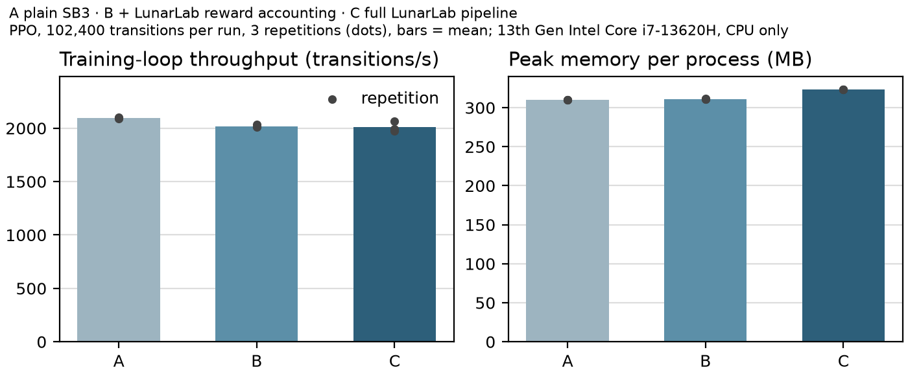

# Benchmark protocol: LunarLab's instrumentation overhead

**Question.** How much time and memory does LunarLab's research instrumentation cost compared with training the
same model with plain Stable-Baselines3? (MLOSS reviewers weigh "comparison to previous … related
implementations, w.r.t. run-time, memory requirements, features".)

**Command.** `python -m lunarlab overhead-benchmark --profile smoke|standard|comprehensive` (implementation:
`lunarlab/overhead.py`; tests: `tests/test_overhead.py`). The comprehensive profile asks for confirmation and is
never started automatically. `python -m lunarlab.overhead --render <folder>` re-creates a folder's table and
figures from its saved raw measurements.

## Configurations

| | Environment stack | Training call |
|---|---|---|
| **A · plain SB3** | `DummyVecEnv([Monitor(gym.make("LunarLander-v3", continuous=False))] × 4)` | `PPO(...).learn(N)` |
| **B · + reward accounting** | `DummyVecEnv([Monitor(LunarLabRewardWrapper(gym.make(...)))] × 4)` (baseline preset: training reward = original reward; per-transition accounting, episode accumulator, outcome classification) | `PPO(...).learn(N)` |
| **C · full LunarLab pipeline** | as B | `lunarlab.training.train(run_id)`: run directory, configuration and metadata records, episode CSV, metrics, status file, stop polling, periodic checkpoints and validation episodes |

**Held equal across A, B and C:** algorithm and hyperparameters (LunarLab's PPO defaults: 4 environments × 1,024
steps per rollout, minibatch 64, 4 epochs, γ = 0.999, GAE λ = 0.98, 64×64 tanh actor and critic, 9,797
parameters) — all three construct SB3's own `PPO` through the same call, and the harness records each run's
hyperparameters and refuses to report if they differ; environment and physics; transition budget (PPO completes
whole rollouts, so budgets are multiples of 4,096 and every run trains exactly the same number of transitions);
`DummyVecEnv`; CPU; one torch thread; seed 0 and the same worker seeds; no rendering.

**What differs, and how it is handled.** C also evaluates the policy on 10 validation episodes at the start,
every N/4 transitions and at the end, and writes a checkpoint every N/4 transitions and at the end (the same
cadence as a real run, scaled to the budget). Validation episodes are *additional environment steps*, not
instrumentation overhead, so their wall time and environment steps are measured separately (by timing
`evaluate_policy` and `save_model_atomic` inside the benchmark process) and excluded from C's training-loop time.
They are reported in their own columns.

**Measurement.** Each repetition runs in a fresh Python process (peak memory is per process and configuration);
the order of A, B and C rotates between repetitions; every repetition is kept. Training-loop time is measured
from environment construction to the end of `learn()`/`train()` (minus C's validation and checkpoint time). CPU
utilisation is process CPU time divided by wall time. Peak memory is the peak working set (Windows) or
`ru_maxrss` (Linux). Artifact size: A and B save one SB3 model file; C's whole run directory. The cost of
recording one episode (video and per-step telemetry) is measured separately after C's training.

## Results (measured)

Machine: Intel Core i7-13620H, Windows 11, 16 GB RAM, Python 3.12.13, torch 2.14.1 (CPU), stable-baselines3
2.9.0, gymnasium 1.4.0; LunarLab 0.1.0 at source revision `28dd935` with this branch's uncommitted changes.
Measured on 2026-10-17. Raw data: `reports/jmlr/benchmarks/standard-2026-10-17T154705+0000/raw.jsonl` and
`…/smoke-2026-10-17T154626+0000/raw.jsonl`.

**Standard profile: 102,400 transitions per run, 3 repetitions per configuration (mean ± SD).**

| Configuration | Training-loop time (s) | Throughput (transitions/s) | Relative loop time | Validation (s; extra env steps) | Peak memory (MB) | Artifacts (MB) |
|---|---:|---:|---:|---:|---:|---:|
| A · plain SB3 | 48.8 ± 0.2 | 2,097 ± 8 | 1.00 | — | 310 | 0.15 |
| B · + reward accounting | 50.7 ± 0.3 | 2,019 ± 13 | 1.04 | — | 311 | 0.15 |
| C · full pipeline | 50.9 ± 1.2 | 2,013 ± 48 | 1.04 | 8.4 (18,780) | 323 | 1.06 |

C wrote 7 checkpoints per run in 0.09 s in total; its whole wall time, validation included, was 59.4 s (1.22 × A).
Recording one 1,000-step episode with video took 5.05–5.26 s (3 measurements).

**Smoke profile: 8,192 transitions, 2 repetitions:** relative loop time B 1.10, C 1.22 (A 2,410 ± 11
transitions/s). At this size the fixed per-run cost (run directory, records, status writes) is a larger share.



**Interpretation.** On this machine, LunarLab's per-transition reward accounting slows PPO training by about
4 % against plain SB3 and adds about 1 MB of peak memory; the rest of the pipeline's run management adds no
measurable further loop time at 102,400 transitions (B and C overlap within their spread) and about 12 MB of
memory. Validation episodes are a research choice whose cost depends on the cadence and is reported separately.
This is one machine, one algorithm and three repetitions; other hardware, `SubprocVecEnv`, more torch threads or
DQN were not measured.

## Not compared

LunarLab was not timed against RL Baselines3 Zoo, CleanRL or imitation: they run different training code
(CleanRL's own PPO, for instance), so a timing difference would not isolate LunarLab's instrumentation. The
feature comparison is in [COMPARISON_EVIDENCE.md](COMPARISON_EVIDENCE.md).

## Reproducing

```powershell
.venv\Scripts\python.exe -m lunarlab overhead-benchmark --profile smoke                     # ~1 minute
.venv\Scripts\python.exe -m lunarlab overhead-benchmark --profile standard                  # ~10 minutes
.venv\Scripts\python.exe -m lunarlab overhead-benchmark --profile comprehensive --yes       # 15 runs of 1,003,520 transitions: hours
```

On Linux use `.venv/bin/python`. Results go to `reports/jmlr/benchmarks/<profile>-<time>/`: `raw.jsonl` (one row
per run, with system information and hyperparameters), `summary.json`, `table.md`, `overhead.png|pdf|svg`.
